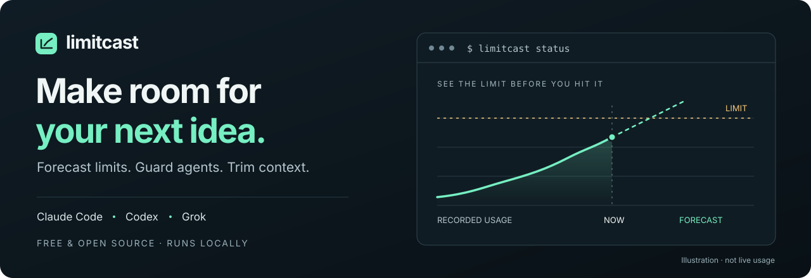

<p align="center">
  
</p>

<p align="center">
  <a href="https://www.npmjs.com/package/limitcast"></a>
  <a href="https://github.com/SamStull9007/limitcast/actions/workflows/ci.yml"></a>
  <a href="LICENSE"></a>
  <a href="https://nodejs.org"></a>
</p>

<p align="center">
  <strong>Get more work from your AI coding plan.</strong><br>
  See when your usage window will run out, control subagent burn,<br>
  and remove starting context you never use.
</p>

<p align="center">
  <a href="#quick-start">Quick start</a> ·
  <a href="#see-it-in-action">Demo</a> ·
  <a href="docs/usage.md">Full guide</a> ·
  <a href="https://limitcast.dev">Website</a> ·
  <a href="CHANGELOG.md">Changelog</a>
</p>

---

## Less overhead. More room to build.

| See what's ahead | Keep agents in check | Start lighter |
| --- | --- | --- |
| Forecast when each usage window will run out and see today's share of your weekly allowance. | Hold new subagents when a window is on pace to run out. See receipts and set budgets. | Measure starting context, identify unused skills and MCP servers, and trim with backups and undo. |
| `limitcast status` | `limitcast install --guard` | `limitcast trim` |

<a id="free-and-open-source"></a>

**Free and open source.** All features are included. No Limitcast account, license key, or subscription required. Runs locally on **macOS and Linux** with **Node.js 20+**.

<a id="install"></a>

## Quick start

```sh
npm install -g limitcast
limitcast onboard              # Read-only setup checks and a first useful result
limitcast install              # Add the status-line recorder
limitcast doctor               # Check the integration
```

Restart Claude Code after installing. Your existing status line stays in place, with the Limitcast line underneath. Installation backs up your settings; `limitcast uninstall` restores them.

Want protection as well as visibility? Enable the optional guard:

```sh
limitcast install --guard
```

The guard holds **new** subagents when a usage window is on pace to run out; existing agents continue. `LIMITCAST_ALLOW=1` overrides a hold. [Guard behavior and thresholds →](docs/usage.md#subagent-guard)

<details>
<summary><strong>Homebrew or Claude Code plugin</strong></summary>

Install with Homebrew:

```sh
brew trust samstull9007/limitcast
brew install samstull9007/limitcast/limitcast
```

Or add the Claude Code plugin for `/limitcast:status`, `/limitcast:results`, `/limitcast:trim`, `/limitcast:memory-audit`, and `/limitcast:memory-split`:

```text
/plugin marketplace add SamStull9007/limitcast
/plugin install limitcast@limitcast
```

The status-line recorder still comes from `limitcast install`.

</details>

## See it in action


### Find the context you carry into every session

```text
$ limitcast trim
Your recorded Claude Code sessions start at 102.7k tokens before your first message.

Estimated removable context: ~6.2k tokens per session (6% of your starting context)
- Disable 9 MCP servers you haven't used in 14 days (~0.9k): postman, context7, ...
- Hide 66 skills from the model (~5.3k): dataviz, block-kit, ...
```

Illustrative output; your findings depend on your local sessions. `trim` inspects first. Use `trim keep <name>` to protect essentials, `trim --apply` to make the changes, and `trim --undo` to reverse them.

## Three tools. One place to understand usage.

| Capability | Claude Code | Codex | Grok |
| --- | --- | --- | --- |
| Usage forecast | Status-line readings | Session logs | Dollar budget or opt-in weekly readings |
| Subagent guard | `Task` / `Agent` | `spawn_agent` | `spawn_subagent` |
| Token report | Supported | Supported | Per-turn ledger |
| Context trim | `trim` | `trim --codex` | `trim --grok` |

**Codex:** forecasts and reports read your existing logs without setup. `install --guard` adds the hook; approve it in Codex before it runs.

**Grok:** reports read local spend. Set a dollar cap with `limitcast budget grok <usd>` for forecasts and guarding, or opt into real weekly usage with `limitcast grok-usage on`. [Provider setup and qualifications →](docs/usage.md#install)

<a id="commands"></a>

## Pick your next move

| I want to… | Run |
| --- | --- |
| See usage, burn rate, and reset times | `limitcast status` |
| Find what's consuming tokens | `limitcast report --why` |
| Limit subagent spend to 15% of a window | `limitcast budget subagents 15` |
| Pace the weekly allowance day by day | `limitcast budget today on` |
| Get a desktop alert | `limitcast notify on` |
| Review activity and protection decisions | `limitcast results` |
| Check the project's memory index | `limitcast memory` |

[All commands, notification options, model controls, and setup details →](docs/usage.md#commands)

## Your data stays yours

Limitcast reads usage readings and session logs already on your machine. Reports remain local, sharing totals is voluntary, and no billing-service connection is required.

Two optional features make network requests, both **off by default**:

- **Phone or webhook notifications** send notification text to the service you choose.
- **Grok weekly usage** reads Grok's existing login and sends it only to grok.com to retrieve your usage. Redirects are refused; the login is never stored or logged by Limitcast.

Context reductions are estimates against a recorded baseline, not measured causal savings or a lower subscription bill. Forecasts depend on observed usage. [How forecasting and measurement work →](docs/usage.md#how-the-forecast-works)

<details>
<summary><strong>Technical reference and upgrade notes</strong></summary>

<a id="subagent-guard"></a>

**Subagent guard:** [Thresholds, overrides, receipts, and cold-cache behavior](docs/usage.md#subagent-guard).

<a id="how-the-forecast-works"></a>

**How the forecast works:** [Sampling, burn rates, weekly pacing, and account separation](docs/usage.md#how-the-forecast-works).

<a id="measuring-recurring-value"></a>

**Measuring recurring value:** [Baselines, time windows, and what the evidence can establish](docs/usage.md#measuring-recurring-value).

<a id="upgrading-to-0150"></a>

**Upgrading from before 0.15.0:** All features are free. Previously preview-only guards enforce after upgrading. [Behavior changes and opt-out](docs/usage.md#upgrading-to-0150).

</details>

## Build with us

Found a rough edge or have an idea? [Open an issue](https://github.com/SamStull9007/limitcast/issues). Contributions are welcome.

```sh
git clone https://github.com/SamStull9007/limitcast.git
cd limitcast
npm test
```

<a id="license"></a>

Created by **Sam Stull** · [MIT License](LICENSE) · [Release history](CHANGELOG.md)
