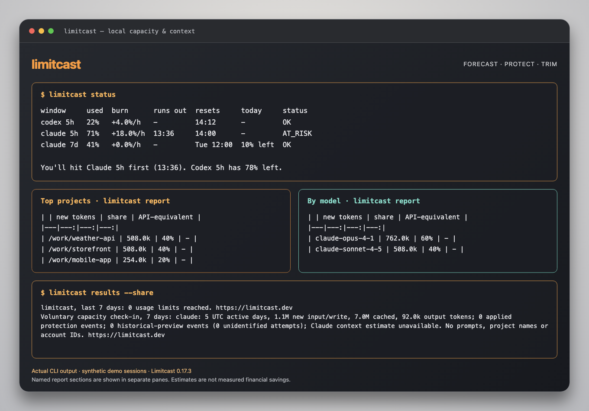

# A quick look at Limitcast

[← Overview](../README.md) · [Quick start](../README.md#quick-start) · [Full usage guide](usage.md)

Three ways to make room in your AI coding plan. The showcase below presents actual CLI output from synthetic demo sessions, arranged in a terminal frame for readability. It is not a desktop app or a promise of savings.



## Forecast your windows

See which usage window is on pace to run out first. The forecast comes from your own readings and recent usage, with daily pacing for weekly windows.

```sh
limitcast status
```

Claude uses status-line readings; Codex reads session logs. Grok requires a dollar budget or opt-in weekly readings. [Forecast method →](usage.md#how-the-forecast-works)

## Give subagents a budget

Enable protection when you want it. A hold prevents a new spawn; it doesn't cancel agents already running. You can override a hold with `LIMITCAST_ALLOW=1`.

```sh
limitcast install --guard
limitcast budget subagents 15
```

Restart your coding tool and approve the Codex hook if prompted. Budgets need calibration from your own readings. [Guard details →](usage.md#subagent-guard)

## Inspect what you load

Find unused starting context before deciding what to change. Keep essential skills and servers, apply cuts explicitly, and undo them when needed.

```sh
limitcast trim
limitcast trim keep <name>
limitcast trim --apply
limitcast trim --undo
```

For other providers, use `trim --codex` or `trim --grok`. Context reductions are estimates against a baseline, not measured financial savings. [Commands and qualifications →](usage.md#commands)

---

**Ready to try it?** [Start here →](../README.md#quick-start)
